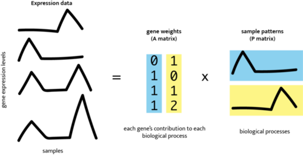

# **Context**
***

 are proteins that cells use to send signals to other cells.  (IFN-beta) belongs to a family called , which also includes IFN-alpha. These signals can change the expression of many genes in responding cells [@platanitis2019interferon].

In the Kang study, researchers used  to measure  in individual cells from the stimulated and untreated samples [@kang2018multiplexed]. This is an example of ****: studying gene expression one cell at a time rather than averaging it across a mixture of cells. The researchers measured RNA, not the amount of interferon itself.

So what would a response to IFN-beta look like in the data? One clue would be finding higher levels of RNA from the same group of genes in stimulated cells than in untreated cells of the same type. In this experiment, we know the researchers added IFN-beta. In blood samples from people with SLE, however, an interferon-related gene expression pattern does not tell us exactly which signal caused it. Understanding how researchers recognize an interferon response will help us interpret both kinds of evidence.

## Recognizing an interferon response in blood cells {#interferon-beta-and-its-role-in-lupus}

In blood samples from some people with SLE, researchers have found that several genes known to respond to interferon are more active together. This pattern is called an  [@catalina2019interferonSLE].

The Kang experiment lets us ask a related but different question: when researchers add IFN-beta to blood immune cells in the lab, which cell types show a similar response? The experiment can tell us how those cells respond to IFN-beta, but not how active lupus was in any individual donor.

Different type I interferons can affect many of the same genes [@catalina2019interferonSLE].

How does a cell respond to that signal? IFN-beta binds to a protein on the cell surface called the  (IFNAR). Proteins inside the cell relay the signal to the nucleus, where they help the cell make more RNA from a group of genes [@platanitis2019interferon]. This relay is called , and the genes whose expression increases are called  (ISGs). That helps explain why we look for several of these genes to change together rather than relying on just one.

```{r}
#| label: fig-context-interferon-signaling
#| echo: false
#| fig-cap: "IFN-beta binds to a receptor on the cell surface. JAK-STAT signaling relays the signal to the nucleus, where the cell can make more RNA from interferon-stimulated genes. In the Kang study, researchers measured RNA in individual cells six hours after stimulation, not the signaling proteins themselves."
#| fig-alt: "Continuous cell cross-section. Outside the cell, interferon beta binds IFNAR. On the inner membrane, TYK2 and JAK1 activate STAT1 and STAT2. The STAT proteins move to the nucleus, where they work with IRF9 at DNA to increase transcription of interferon-stimulated genes. Wavy strands represent new RNA, not measured counts."
#| out-width: "900px"
#| out-extra: '.lightbox title=""'
ottrpal::include_slide(
  "https://docs.google.com/presentation/d/12zD5D9qLNHgo_3mc6OFsZqY-D8aCrnKh0l_jXt6dP_8/edit#slide=id.p1"
)
```

A shared response need not look the same in every cell type. For example, in the SLE datasets that Catalina and colleagues studied, more interferon-stimulated genes showed elevated expression in monocytes than in T cells or B cells [@catalina2019interferonSLE]. That finding gives us a reason to look at the cell types separately in the Kang data, without assuming we'll find the same differences.

## PBMCs as a mixed immune-cell system

, or PBMCs, are a mixture of blood immune cells, including T cells, B cells, ,  and some . They represent several, but not all, of the immune-cell types found in blood.

These cell types have different roles and characteristic . A monocyte, for example, can respond to IFN-beta while retaining expression features that distinguish it from a T cell. Both cell types may increase expression of some of the same interferon-stimulated genes, but their responses need not be equally strong.  and response to stimulation can therefore contribute to the same cell's expression profile [@kang2018multiplexed; @kotliar2019identityActivity].

Single-cell measurements let you examine these differences separately. You can compare control and stimulated cells of the same type, then ask whether other cell types show similar changes. This matters because an average across all cells can change simply because a sample contains different proportions of cell types, even without expression changes within those types [@kang2018multiplexed].

Not every difference reflects stimulation. Cells can also differ between , and the measurements capture only part of the RNA present in each cell. Later, you will use the recorded cell type, donor and condition alongside the expression data to help interpret the patterns you find.

## Summary of the Kang et al. study

In the experiment used here, Kang and colleagues studied PBMCs from eight donors with SLE. Each donor's sample was divided into two portions, or : one exposed to IFN-beta and one left untreated. RNA was measured in individual cells after six hours [@kang2018multiplexed].

This is a  because researchers deliberately changed the cells' environment to study their response. It also uses a : each donor contributes samples to both conditions. Comparing conditions within donors helps account for differences between people. The pairing is between samples from the same donor, not the same cells measured before and after stimulation.

After incubation, cells were combined into two pools, one per condition, and captured in tiny droplets for RNA sequencing. The researchers developed **demuxlet** to use genetic differences between donors to assign cells back to their source, a process called . It also helped identify droplets containing cells from two different donors, a type of , so those mixed observations could be excluded [@kang2018multiplexed].

Next, we will look at what the original study found. The files used in our analysis are described later in [**What are the data?**](#what-are-the-data).

## Source-study findings to carry forward

Kang and colleagues reported three findings that are especially useful for interpreting this experiment [@kang2018multiplexed]:

- **Responses were partly shared and partly cell-type-specific.** Thousands of genes differed in  between stimulated and untreated cells in at least one cell type. Some changes occurred across several cell types; others were limited to particular types.
- **Cell types remained recognizable.** The researchers could still identify the major immune-cell groups in both conditions, despite the changes in gene expression.
- **Donors differed too.** Some expression differences between  were related to the proportions of cell types in their samples. Other differences remained when the researchers compared cells of the same type.

These are findings from the original study, which did not use CoGAPS. Here, you will examine whether CoGAPS reveals similar features in the prepared data. The next subsection introduces genes that can help you recognize an interferon response.

## Recognizing interferon-response genes {#interferon-genes-learners-should-recognize}

Later tables will contain gene symbols such as `ISG15`, `IFIT1` and `MX1`. These symbols are short names for genes. Recognizing a few will help you connect the results to the interferon response described above.

 can have different roles. Some encode proteins that help defend against viruses, while others help regulate the response or communicate with other cells. Examples you will encounter include:

- **`IFIT1`: antiviral defense.** Its protein can interfere with the production of viral proteins [@habjan2013ifit1].
- **`OAS1`: antiviral defense through RNA breakdown.** Its protein can activate a process that breaks down RNA [@wickenhagen2021oas1].
- **`IRF7`: regulation.** Its protein helps control the expression of interferon genes [@honda2005irf7].
- **`CXCL10`: communication.** Its protein helps attract immune cells [@taub1993cxcl10].

These descriptions come from studies of the genes and their proteins. Here, we measure RNA, so we cannot directly determine whether each protein is carrying out its known function.

When several genes associated with interferon responses appear together in a pattern, they give you a reason to investigate that interpretation. You will also check whether the pattern is more prominent in stimulated cells and whether those genes have higher or lower expression than in untreated cells. A large CoGAPS  alone does not tell you the .

## From cell clusters to latent patterns

One way to explore single-cell data is to group cells with similar . This is called . Researchers examine the genes expressed in each group to help interpret it; a cluster is not automatically a cell type [@kiselev2019singleCellClustering].

A cluster label does not describe every response within a cell. For example, a stimulated monocyte may retain expression features associated with monocytes while increasing expression of interferon-stimulated genes. A stimulated T cell may show some of those same changes. The cells need not belong to the same cluster for part of their response to be shared [@kotliar2019identityActivity].

CoGAPS offers another way to describe these data. It looks for gene-expression patterns and estimates how strongly each pattern is represented in each cell. These are called  because the model infers them from the expression measurements rather than receiving them as recorded labels. A cell can have contributions from several patterns [@steinobrien2019transferLearning].

Two linked outputs help you examine each pattern: , which describe how strongly genes contribute to it, and , which describe how strongly it is represented in each cell. Here, activity is a model estimate, not a direct measurement of a protein's activity.

The prepared dataset already includes cell-type labels. You will compare these labels with the pattern activities to ask whether a pattern is more prominent in a particular cell type, in stimulated cells across several types, or both. The contributing genes will help you interpret that pattern. Differences between donors or in how samples were measured can also influence the results, so a learned pattern is not automatically a distinct biological process.

::: {.callout-note collapse="true" title="Optional: UMAP, PCA and CoGAPS"}

UMAP, principal component analysis (PCA), and CoGAPS offer different ways to explore expression data. Here, we use UMAP as a two-dimensional display of the cells, which we can color by cell type, condition, or pattern activity. PCA produces gene loadings and cell scores along perpendicular directions that explain variation in the data; those loadings and scores can be positive or negative. CoGAPS instead represents expression using nonnegative, additive gene weights and cell activities. This lets us investigate overlapping candidate programs, such as cell identity and an interferon response within the same cell. Neither PCA nor CoGAPS automatically assigns biological meaning to its components.

:::

:::{.think_question}
::::{.think_question_header}
Stop and think
::::
::::{.inner_block}
If a pattern is more prominent in stimulated monocytes and stimulated T cells, what might it represent, and what would you check next?

<details><summary>Answer</summary>
It might reflect a response shared across those cell types. Examine its contributing genes and compare its activity in stimulated and untreated cells within each type before interpreting it as an interferon response.
</details>
::::
:::

The next subsection explains how gene weights and cell activities work together to represent the expression data.

## NMF: the mathematical shape of the problem

How do gene weights and cell activities combine to describe expression? Start with a , a rectangular arrangement of numbers. In the modeling input used here, each row represents a gene and each column represents a cell. An entry therefore describes one gene's expression in one cell.

These entries are prepared expression values, not original RNA counts. The counts have been  to account for differences in the total counts measured per cell, then  to compress large values. The original counts are retained separately for later comparisons.

, or NMF, represents this input using two linked matrices:  and . For a chosen number of patterns, written as $K$, the model estimates values in these matrices whose product approximates the input. In the notation used here, this is written as $D \approx AP$ [@steinobrien2019transferLearning].

| Matrix | Rows | Columns | Meaning |
|---|---|---|---|
| $D$ | Genes | Cells | Prepared expression values supplied to the model |
| $A$ | Genes | Patterns | Each gene's weight in each pattern |
| $P$ | Patterns | Cells | Each pattern's activity in each cell |

The pattern columns of $A$ correspond to the pattern rows of $P$. Both contain the same $K$ patterns. In the saved activity tables you will inspect later, cells appear in rows and patterns in columns instead; the arrangement is reversed.

To estimate the expression value for one gene in one cell, multiply that gene's weight in each pattern by the pattern's activity in the cell. Then add those contributions.

**Illustrative example:** suppose there are two patterns. For one gene, the weights are 2 and 1; in one cell, the corresponding activities are 0.5 and 0.2. The estimated expression value is $(2 \times 0.5) + (1 \times 0.2) = 1.2$.

**Non-negative** means that the weights and activities are zero or positive, so their contributions add rather than subtract. This does not mean that expression must increase after stimulation: expression can still be lower in one condition than another. The restriction concerns how the model represents each cell [@lee1999nmf].

::: {.callout-note collapse="true" title="Optional: reading the equation for one gene and cell"}

$$
D_{g,c} \approx \sum_{k=1}^{K} A_{g,k} P_{k,c}
$$

Here, $g$ identifies a gene, $c$ identifies a cell, and $k$ identifies a pattern. $A_{g,k}P_{k,c}$ is that pattern's contribution to the estimated expression value. The summation symbol means to add these contributions across all $K$ patterns.

:::

The symbol $\approx$ means "approximately equal." The combined patterns summarize the input rather than reproduce every value exactly. Their biological meaning still needs to be investigated. The next subsection introduces CoGAPS, the particular NMF approach used in this case study.

## How CoGAPS estimates patterns and uncertainty {#how-cogaps-extends-vanilla-nmf}

, short for Coordinated Gene Activity in Pattern Sets, is the method we use to estimate gene weights and cell activities. It follows the non-negative matrix representation introduced above and also estimates uncertainty in those values. The method was introduced by Fertig and colleagues and subsequently developed for single-cell data [@fertig2010cogaps; @steinobrien2019transferLearning].

:::: {.columns}
::: {.column width="22%"}
{fig-alt="CoGAPS logo showing a stylized bird beside the letters A and P, the two CoGAPS output matrices." width="130"}
:::

::: {.column width="78%"}
{fig-alt="Schematic from the CoGAPS User Guide showing an input matrix represented by pattern matrices and corresponding pattern profiles." width="100%"}
:::
::::

*Image credit: CoGAPS logo and schematic from the [Fertig Lab CoGAPS User Guide](https://fertiglab.github.io/CoGAPSGuide/){target="_blank"}.*

How does CoGAPS estimate the weights and activities? It uses a , which combines information from the expression data with assumptions about the values being estimated. During fitting, it repeatedly samples possible values for the gene weights and cell activities according to this model. Here, "sampling" refers to exploring model values, not collecting more cells or donors [@fertig2010cogaps].

CoGAPS summarizes these sampled values in two useful ways. The **means** provide estimates of the gene weights and cell activities. Their  describe how spread out the sampled values are around those means. These are summaries of uncertainty in the model estimates, not measurements of how much gene expression varies between cells [@johnson2023cogapsWorkflow].

 do not replace checks of the model run. Later, you will inspect saved diagnostic plots to examine how the estimates changed during fitting. You will also compare results from separate runs to see whether important features recur. Separate runs can produce different pattern orders and sometimes different patterns, so a pattern number is not a fixed biological name [@johnson2023cogapsWorkflow].

These checks help you judge the model's behavior. Interpreting its patterns still requires examining the contributing genes and comparing cell activities with the recorded cell types and stimulation conditions.

The main interpretation in this case study uses the saved R CoGAPS model. Parallel Python examples are provided in the language tabs. The [CoGAPS User Guide](https://fertiglab.github.io/CoGAPSGuide/){target="_blank"} provides further information about both workflows.

::: {.callout-note collapse="true" title="Optional: Gene weights and pattern-specific markers"}

Ranking gene weights identifies the largest weights within one pattern. A gene can have a large weight in several patterns, so this ranking does not establish that it is specific to one pattern. **PatternMarkers** instead compares a gene's relative weights across patterns. Neither comparison determines whether expression increases or decreases after stimulation. The main analysis uses gene-weight-ranked lists [@steinobrien2017patternMarkers].

:::

Before fitting the model, we must choose how many patterns it can learn. This number, $K$, affects how broadly or finely the model describes the data. The next subsection explains that choice.

## What choosing `K` means

**$K$ sets the number of patterns CoGAPS will estimate.** This setting is also called the model's rank or . In the two-pattern example above, $K = 2$: each gene has two weights, and each cell has two activities. $K$ does not specify how many cell types are present or how many biological processes truly occur.

With fewer patterns, the model has fewer ways to describe differences in gene expression. For example, a small model might capture a broad interferon response while combining expression features associated with different immune-cell types in its other patterns. Those cell-type differences could then be harder to examine separately.

Allowing more patterns may help distinguish those features. However, additional patterns can also describe similar features without providing a more useful explanation. A larger $K$ is therefore not automatically better. Each choice requires a new model fit; increasing $K$ does not simply preserve the existing patterns and add another one [@johnson2023cogapsWorkflow].

For this case study, a useful choice should help us examine both the response to IFN-beta and differences among immune-cell types. We therefore compare results from several values of $K$ rather than choosing from the number alone.

The next subsection explains how that comparison works. In [Data Import](#compare-k4-k5-and-k6-candidate-models), you will inspect the saved comparisons and the evidence supporting the model used for the main analysis.

## Why run a rank sweep?

A  compares models fitted with different values of $K$. For example, comparing $K = 4$, $K = 5$ and $K = 6$ means examining separate CoGAPS fits with four, five and six patterns.

Some settings are also fitted more than once using different **random seeds**, numbers that control the random choices made during fitting. Comparing different values of $K$ shows how the results change with the number of patterns. Repeating a fit at the same $K$ helps us check whether important findings recur across runs [@johnson2023cogapsWorkflow].

In this case study, those models have already been fitted. You will inspect saved summaries to consider four questions:

- **Is there a recognizable interferon response?** Look for a pattern whose activity is higher in stimulated cells and whose contributing genes include known interferon-response genes.
- **Does that response recur across runs?** Compare its association with stimulation and its highest-weight genes across repeated fits at the same $K$.
- **What else can the model distinguish?** Examine whether the other patterns help describe differences among immune-cell types, rather than combining those differences into a few broad patterns.
- **What do additional patterns add?** Consider whether a larger $K$ makes useful differences easier to interpret, whether patterns describe similar features, and how much longer fitting takes.

These comparisons help us weigh consistency, biological detail and computing time together. A model with the strongest association with stimulation is not necessarily the most useful model for examining both the shared response and differences among immune-cell types.

## How pattern evidence will be interpreted later

Once a model has been selected, you will ask what its patterns might represent. For each pattern, you will connect three kinds of information:

1. **Which cells show the pattern?** Compare  between control and stimulated samples from the same donor, and examine activities within the recorded cell types. This helps distinguish a response shared across several immune-cell types from a pattern concentrated in one type. A pattern can also reflect both cell type and stimulation.

2. **Which genes contribute most strongly?** Examine the genes with the largest  and consider their known functions. Several genes associated with the same biological process can suggest an interpretation, but a familiar gene alone is not enough to name the pattern [@johnson2023cogapsWorkflow].

3. **How does gene expression differ between conditions?** Compare expression in stimulated and control samples from the same donor. These  checks show whether relative expression is higher or lower after stimulation. A large CoGAPS gene weight does not provide that direction.

For example, high weights for IFIT1 and OAS1 would make an interferon-response interpretation worth investigating. Higher pattern activity in stimulated samples across several cell types and donors would strengthen that interpretation. The expression comparisons would then show which contributing genes are higher or lower after stimulation.

```{r}
#| label: fig-context-pattern-evidence
#| echo: false
#| fig-cap: "Interpreting a CoGAPS pattern involves comparing cell activities across conditions and cell types, examining contributing genes, and checking expression direction separately. Control and stimulated samples are paired by donor, not by individual cell. The diagrams illustrate the reasoning process rather than fitted results. Researcher illustration adapted from Avataaars (Pablo Stanley; Fang-Pen Lin). See Acknowledgments for artwork credits."
#| fig-alt: "Four-panel conceptual comic following one unnamed CoGAPS pattern. First, different control and IFN-beta-stimulated cells from the same donor show lower and higher pattern activity within T cells, B cells and monocytes. Second, gene-weight bars for IFIT1 and OAS1 are considered alongside their known interferon-response functions. Third, lines connect relative-expression summaries from control and stimulated samples from the same donor, not individual cells. Finally, the clues support a possible shared interferon response, with a reminder to keep the interpretation open if they disagree. All values are schematic, not fitted results."
#| out-width: "900px"
#| out-extra: '.lightbox title=""'
ottrpal::include_slide(
  "https://docs.google.com/presentation/d/1TnWgyP9Xi9s3kknD5V7rz8YYJnsQAByQYz4pCNF0erk/edit#slide=id.p1"
)
```

You will also inspect saved diagnostic plots and  to look for problems in the fit and uncertainty in the estimated values. These checks assess the model; they do not establish what a pattern means biologically.

Together, these observations support an interpretation without requiring every pattern to have a definitive biological label. When the clues do not agree, the interpretation should remain tentative.

:::{.definition_box}
::::{.definition_box_header}
Core distinctions to carry forward
::::
::::{.inner_block}

- **Cell type and response:** A cell can respond to IFN-beta while retaining expression features associated with its cell type.
- **Clusters and patterns:** Clustering groups cells with similar expression profiles. A latent pattern can appear in cells from several clusters.
- **Gene weights and expression changes:** A large gene weight indicates a strong contribution to a pattern. A separate comparison shows whether the gene's relative expression is higher or lower after stimulation.
- **`K` and pattern numbers:** `K` is the number of patterns fitted. Labels such as `Pattern1` identify patterns within a particular fit and can refer to different patterns in another fit.
::::
:::

These comparisons describe a laboratory response to IFN-beta. [Limitations](#limitations) explains why they cannot establish how SLE develops or predict patient outcomes.

Next, [What are the data?](#what-are-the-data) introduces the prepared dataset and saved CoGAPS outputs you will use to investigate the main questions.

***
