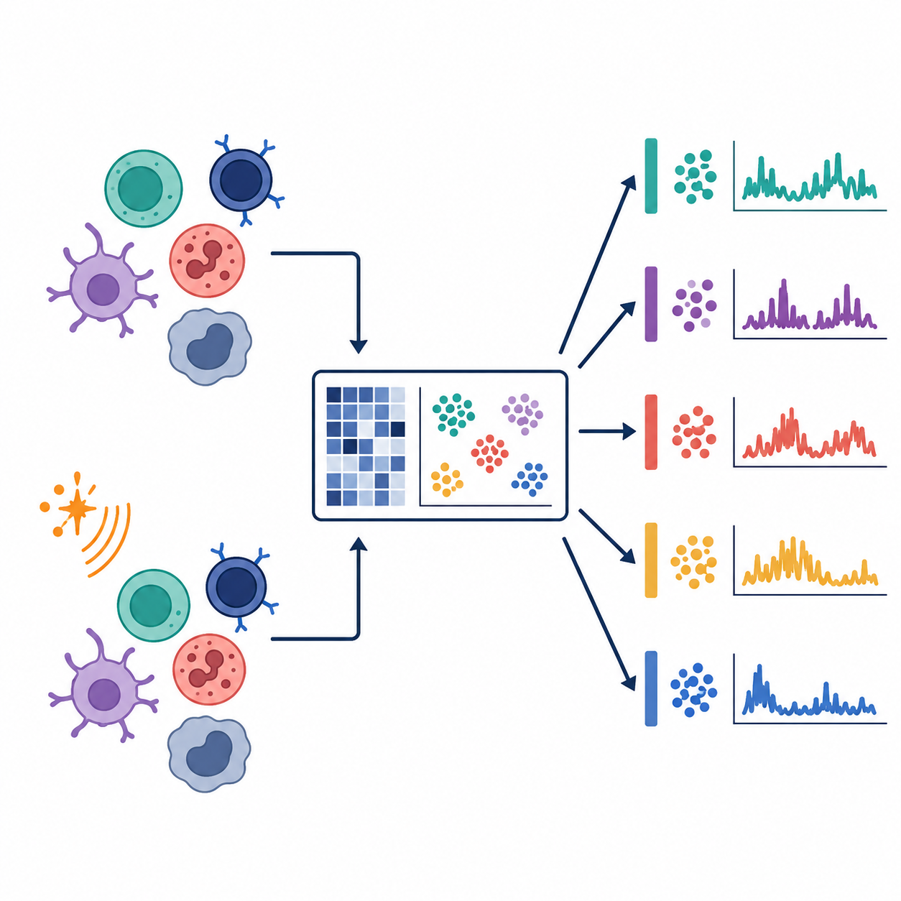
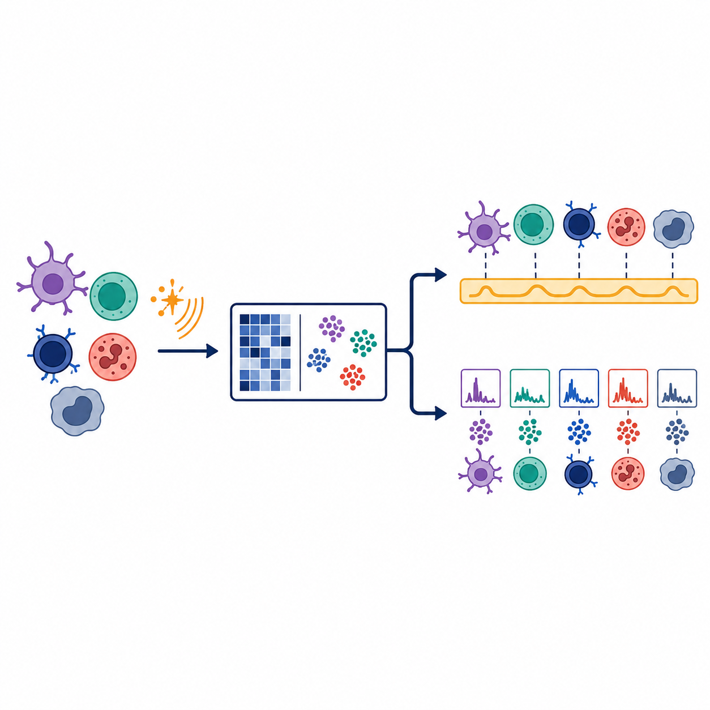
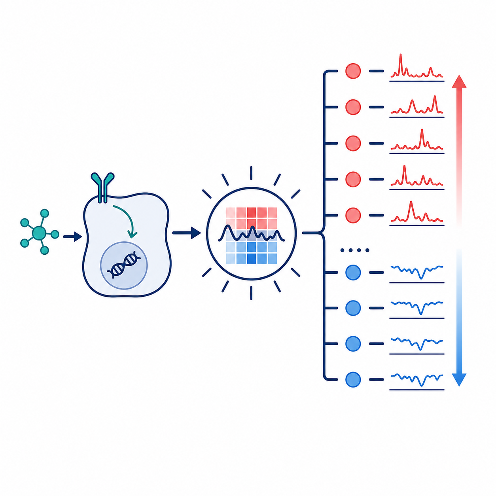
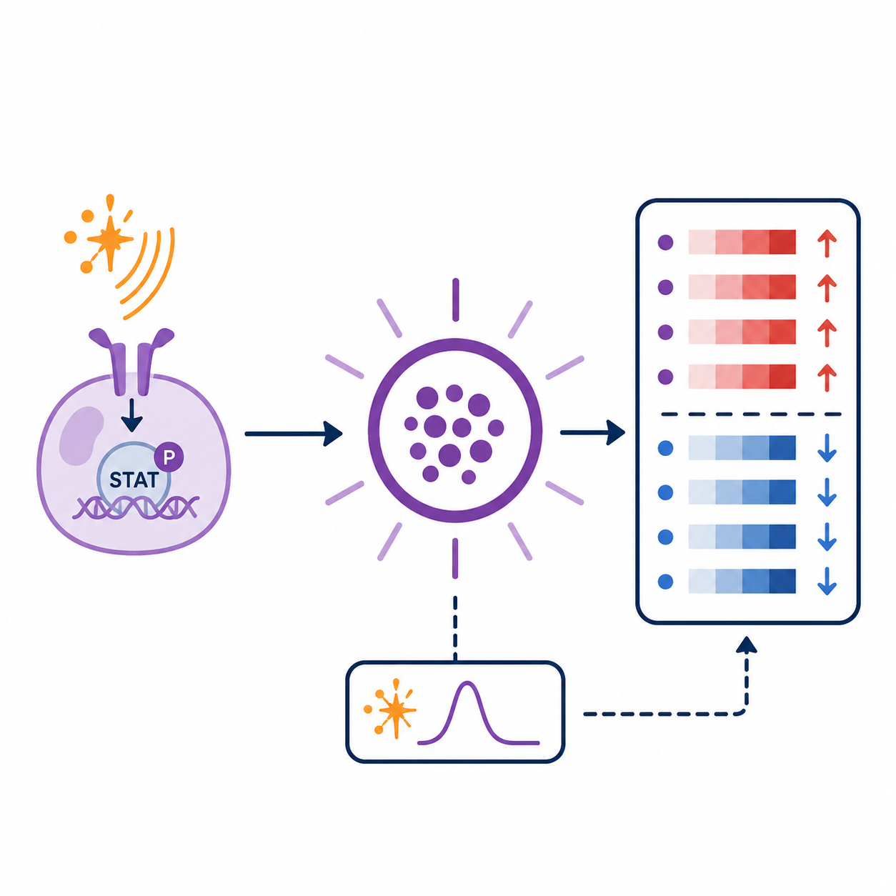

# **Main Questions**
***

The researchers studied  (PBMCs), a mixture of blood immune cells that includes T cells, B cells, and monocytes. For each donor, the researchers exposed one portion of the sample to IFN-beta and left another untreated as a control. Comparing the two portions from the same donor is called a .

CoGAPS looks for : groups of genes whose expression tends to vary together across cells. Is a pattern strong in T cells whether or not they were stimulated? Or is it stronger after stimulation in several cell types? Both can be true. To explore these possibilities, you'll use the ** that CoGAPS estimates for each pattern in each cell: a measure of how strongly that pattern appears in the cell.

:::{.main_question}
::::{.main_question_header}
Our main questions
::::
::::{.inner_block}
1. What  are present in IFN-beta stimulated and control PBMC  data?
1. Can CoGAPS help distinguish broad  from ?
1. Which genes define the strongest , and what is their  in stimulation?
1. How does the IFN-associated pattern vary across annotated PBMC cell types?
::::
:::

<table style="min-width: 900px; border-collapse: separate; border-spacing: 0 0.85rem;">
<colgroup>
<col style="width: 200px;">
<col style="width: 29%;">
<col style="width: 32%;">
<col style="width: 27%;">
</colgroup>
<thead>
<tr style="vertical-align: top;">
<th></th>
<th>Research question</th>
<th>Where it is answered</th>
<th>What you should learn</th>
</tr>
</thead>
<tbody>
<tr style="vertical-align: top;">
<td>{.lightbox group="main-question-images" width="180" style="max-width: 100%; height: auto;" fig-alt="Icon showing control and IFN-beta stimulated PBMC groups entering a single-cell analysis block and branching into multiple colored latent program signals."}</td>
<td><strong>Question 1</strong> What latent transcriptional programs are present in IFN-beta stimulated and control PBMC single-cell RNA-seq data?</td>
<td><a href="#data-import"><strong>Data Import</strong></a> introduces the teaching PBMC dataset and the saved CoGAPS results used for the main analysis. <a href="#data-exploration"><strong>Data Exploration</strong></a>, <a href="#data-visualization"><strong>Data Visualization</strong></a>, and <a href="#data-analysis"><strong>Data Analysis</strong></a> then inspect the learned gene weights, cell activities, and pattern summaries.</td>
<td>CoGAPS represents the PBMC data as multiple latent transcriptional patterns rather than one label per cell. Those patterns become the signals you will interpret in later sections.</td>
</tr>
<tr style="vertical-align: top;">
<td>{.lightbox group="main-question-images" width="180" style="max-width: 100%; height: auto;" fig-alt="Icon showing a CoGAPS analysis splitting into one shared activity band across cell types and separate cell-type-specific program panels."}</td>
<td><strong>Question 2</strong> Can CoGAPS help distinguish broad stimulation-associated activity from cell-type-linked immune programs?</td>
<td><a href="#data-exploration"><strong>Data Exploration</strong></a> and <a href="#data-visualization"><strong>Data Visualization</strong></a> show how cells are grouped by condition and cell type. <a href="#data-analysis"><strong>Data Analysis</strong></a> compares how strongly each pattern follows stimulation, which genes define it, and where its activity is strongest across labeled cell types.</td>
<td>A useful model should help separate a broad stimulation-associated activity signal from patterns that look more cell-type-linked or mixed.</td>
</tr>
<tr style="vertical-align: top;">
<td>{.lightbox group="main-question-images" width="180" style="max-width: 100%; height: auto;" fig-alt="Icon showing IFN signaling into a cell, a highlighted pattern module, and a ranked red and blue gene list for up- and down-direction genes."}</td>
<td><strong>Question 3</strong> Which genes define the strongest IFN-associated pattern, and what is their direction in stimulation?</td>
<td><a href="#data-visualization"><strong>Data Visualization</strong></a> previews how top pattern genes can be paired with expression direction. <a href="#data-analysis"><strong>Data Analysis</strong></a> identifies the IFN-associated pattern from cell activities, ranks its top genes, and checks whether those genes are higher or lower in IFN-beta-stimulated cells.</td>
<td>The IFN-associated interpretation should be supported by canonical , and  must be interpreted alongside directionality.</td>
</tr>
<tr style="vertical-align: top;">
<td>{.lightbox group="main-question-images" width="180" style="max-width: 100%; height: auto;" fig-alt="Icon showing an IFN-associated pattern branching into multiple PBMC cell-type rows with distinct mini expression profiles."}</td>
<td><strong>Question 4</strong> How does the IFN-associated pattern vary across annotated PBMC cell types?</td>
<td><a href="#data-visualization"><strong>Data Visualization</strong></a> previews IFN-associated activity by cell type and condition. <a href="#data-analysis"><strong>Data Analysis</strong></a> compares the pattern across labeled PBMC cell types and checks whether the same gene-direction story appears within those groups.</td>
<td>The IFN-associated pattern should be read as broad but not uniform: its cell activity can cut across immune-cell identities while still varying in strength across cell types.</td>
</tr>
</tbody>
</table>

The questions are ordered intentionally. First you inspect the latent patterns that CoGAPS learns. Then you separate shared stimulation structure from cell-type-linked structure. Only after that do you attach biological meaning through top genes, directionality, and cell-type summaries.

***
