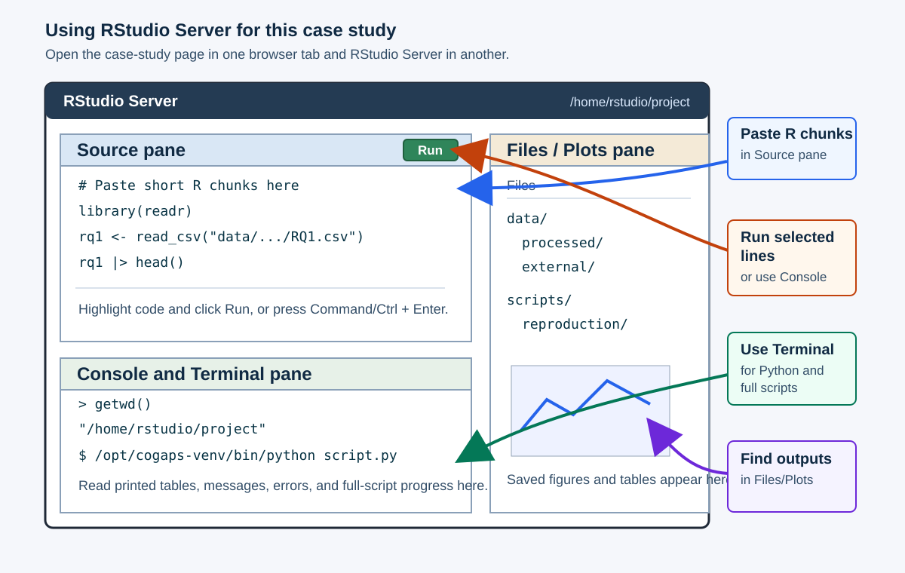

# **Packages and Setup**
***

This section gets your computer ready for the case study. The main learner path uses the case-study repository, the validated Docker image, included teaching data, saved model-selection summaries, and lightweight exports from the selected CoGAPS model. That path lets you focus on importing, checking, visualizing, and interpreting evidence without waiting for long model runs.

The full local reproduction path is optional. It uses the same repository and Docker image, but adds larger files so a reviewer, instructor, or advanced learner can regenerate selected-model outputs. The high-performance-computing sweep is not rerun in the main learner path; later sections inspect the included sweep summaries instead.

This case study uses R as the primary implementation and Python as a parallel implementation in the second tab. The R path uses `SingleCellExperiment` and Bioconductor `CoGAPS`; the Python path uses `AnnData` and PyCoGAPS-compatible saved outputs. The scientific workflow is the same in both languages, but saved CoGAPS outputs are kept separate because the two implementations should be treated as parallel analyses rather than numerically identical reruns.

## What the setup provides

Think of setup as four connected pieces:

| Setup piece | What it provides | When you need it |
|---|---|---|
| Docker image | R, Python, CoGAPS, PyCoGAPS, Quarto, plotting tools, and the OpenMP-enabled runtime used for this case study. | Use this for the main learner path and for full local reproduction. |
| GitHub repository | The case-study pages, scripts, manifests, included teaching data, selected-model summaries, and figures. | Use this for the main learner path. |
| Optional large-file archive | Larger source or model files, such as full model objects or dense CoGAPS inputs, that are not kept in ordinary GitHub history. | Use this only for full local reproduction or deeper audit work. |
| HPC sweep provenance | Included sweep summaries and scripts documenting the broader rank search. | Inspect the summaries in the lesson; rerunning the sweep is separate cluster work. |

The first figure keeps those pieces separate. Docker supplies the software environment. GitHub supplies the files used in the main lesson. Optional Zenodo or local files support deeper rebuilding, and the HPC sweep remains a separate provenance layer.

{#fig-packages-setup-resources-cs4 width="100%" .lightbox}

The second figure shows how the main learner path differs from full local reproduction. Follow the left path for the case study itself. Use the upper-right path only if you want to rebuild selected files after obtaining the larger inputs. Treat the lower-right HPC sweep as provenance: the case study includes the sweep summaries so you can evaluate rank evidence without launching cluster jobs.

{#fig-packages-setup-workflow-cs4 width="100%" .lightbox}

## Main learner setup

Start here to run the main learner path. If you only want to read the rendered case study, you can skip software setup.

### Check that Docker is ready

Open Docker Desktop and wait for it to finish starting. Use your computer's Terminal, or the **Terminal** tab in RStudio if you already have it installed. Do not use the R **Console**. This check runs on your computer, before you open the lesson's browser-based RStudio environment.

The commands below use Bash-style syntax: use Terminal on macOS or Linux, or a WSL terminal with [Docker Desktop integration enabled](https://docs.docker.com/desktop/features/wsl/){target="_blank"} on Windows, rather than PowerShell or Command Prompt.

**Host Terminal (on your computer)**

```bash
docker info
```

Look for a `Server` section containing a server version and system information, without a connection error. A `Client` section alone does not confirm that Docker is ready.

If you see "Cannot connect to the Docker daemon," check that Docker Desktop is open and has finished starting, then try again. If `docker` is not found, check your Docker installation. For further help, see the [Docker Desktop troubleshooting guide](https://docs.docker.com/desktop/troubleshoot-and-support/troubleshoot/){target="_blank"}.

### Download the project

Choose one method. Download the ZIP if you do not already use Git.

**Option 1: Download ZIP**

1. [Download the case-study ZIP](https://github.com/opencasestudies/ocs-bio-latent-variable/archive/refs/heads/main.zip).
2. Extract the ZIP, then open the extracted folder. The extracted folder should contain `index.qmd`, `scripts`, and `data`. This is the **project root**, the main folder for the case study.

In the **Host Terminal**, use `cd` to change to that folder. The examples below assume you extracted the ZIP in your Downloads folder.

For **macOS or Linux**:

```bash
cd "$HOME/Downloads/ocs-bio-latent-variable-main"
```

For **Windows using WSL**, a typical path is:

```bash
cd "/mnt/c/Users/YOUR_USERNAME/Downloads/ocs-bio-latent-variable-main"
```

Replace `YOUR_USERNAME` with your Windows user-folder name. WSL uses `/mnt/c` to access your Windows C: drive. [Windows/WSL path guidance](https://learn.microsoft.com/en-us/windows/wsl/filesystems)

If you extracted the project somewhere else or renamed its folder, use that location instead. Keep the quotation marks so paths containing spaces work.

**Option 2: Clone with Git**

If you already use Git, open the **Host Terminal** in the folder where you want to keep the case study, then run:

```bash
git clone https://github.com/opencasestudies/ocs-bio-latent-variable.git
cd ocs-bio-latent-variable
```

### Check the project root

After either download method, check that your Terminal is working in the case-study folder. `pwd` shows your current location, and `ls` checks for the required file and folders.

**Host Terminal**

```bash
pwd
ls -d index.qmd scripts data
```

Continue when all three entries are listed without a missing-file error. If something is missing, use `cd` to move into the folder containing those entries and repeat the check.

Run the Docker launch command below from this same folder, not from Downloads or another folder containing the ZIP. This makes the case-study files available in RStudio.

### Launch the case-study environment

Run the commands below from your case-study folder to download the software used in this lesson and start RStudio for use in your web browser.

**Host Terminal**

```bash
docker pull --platform linux/amd64 othomas2/pycogaps-runtime-guide:0.3.0

docker run --platform linux/amd64 --rm -it \
  -p 127.0.0.1:8787:8787 \
  -e PASSWORD="Password12" \
  -v "$PWD":/home/rstudio/project:rw \
  othomas2/pycogaps-runtime-guide:0.3.0
```

In RStudio, your downloaded case-study folder appears at `/home/rstudio/project`. These are the same files stored on your computer, not a separate copy. Files you create or edit in this folder through RStudio remain in your local case-study folder after you stop Docker.

The `127.0.0.1` port mapping makes RStudio available only from your own computer. Keep that address in the command when using the example password below.

Keep `--platform linux/amd64` unchanged in both commands, including on Apple silicon Macs.

## Full local reproduction setup

<details>
<summary><strong>Optional: inspect or rebuild full model outputs</strong></summary>

The main lesson uses the included data and saved results. You can skip this section and continue to [Open RStudio Server](#open-rstudio-server).

To inspect full model objects or rerun parts of the analysis, follow the [Full Reproduction Guide](#full-reproduction-guide). Check the required files for your chosen stage before starting; some are separate downloads. The guide uses R for full reproduction and includes an optional Python route. You do not need both.

When following the guide:

- Start model runs in the **Host Terminal**, from your case-study folder. Keep Docker Desktop running and the model's progress visible.
- Run preprocessing and export commands in the **RStudio Terminal inside the container**, from `/home/rstudio/project`.

</details>

## Open RStudio Server

After Docker starts, open [http://localhost:8787](http://localhost:8787){target="_blank"} and sign in with username `rstudio` and password `Password12`. Keep the online case-study page open in one browser tab and RStudio Server open in another.

In RStudio Server, work from `/home/rstudio/project`, the mounted project folder. Set the working directory in each session you use before running code with relative file paths.

**RStudio Console**

```r
setwd("/home/rstudio/project")
getwd()
```

**RStudio Terminal inside the container**

Open the Terminal tab in RStudio, then run:

```bash
cd /home/rstudio/project
pwd
```

Each check should report `/home/rstudio/project`. The RStudio Console and the RStudio Terminal inside the container have separate working directories: changing one does not change the other. Use `getwd()` to check R's location and `pwd` to check the Terminal's location.

The schematic below labels the main panes you will use while working through the case study.

{#fig-rstudio-server-labeled-cs4 width="100%"}

Choose one language for the main lesson. In the browser-based RStudio, use the corresponding workflow below.

| Code | Where to run it | Where results appear |
|---|---|---|
| R | Add code to a saved R script in the **Source** pane. Select the lines and click **Run**. | **Console** and **Plots** pane |
| Python | Enter code in a **Python session** started from the **RStudio Terminal inside the container**. | **Terminal**; saved output in the **Files** pane |

Files you save in `/home/rstudio/project` are available through RStudio's **Files** pane.

Choose the tab for your language and follow the instructions below.

::: {.panel-tabset}

### R

**Keep your work in a saved script**

Choose **File > New File > R Script** and save the new file as `case_study_work.R` in `/home/rstudio/project`. Add successive R chunks to this script as you work through the case study. Highlight the lines you want to run and click **Run**; they execute in the RStudio Console. Use the Console directly for brief checks such as `getwd()`, rather than keeping your only copy of the workflow in the Console history.

Keep `setwd("/home/rstudio/project")` and the package and helper setup chunks near the top of your script. When you return to a new R session, reopen the script and rerun those setup chunks and any earlier chunks that create objects needed by the section you are resuming. Saving the script preserves your code, not the objects in an R session. Files saved in the mounted project folder remain in your local project when the container stops.

### Python

**Start a separate session**

For Python chunks, start the existing Python workflow from the Terminal pane, not the RStudio Console.

**RStudio Terminal inside the container**

```bash
cd /home/rstudio/project
/opt/cogaps-venv/bin/python
```

**Python session**

Once the `>>>` prompt appears, paste Python code only; do not include the prompt itself. For longer Python examples, save the code in a `.py` file in `/home/rstudio/project` and run it with `/opt/cogaps-venv/bin/python` from the RStudio Terminal inside the container. Run `exit()` in the Python session to return to the Terminal before entering shell commands such as `cd`.

:::

## Load packages

The Docker image already installs the packages used below. Load the packages for the language you plan to use.

::: {.panel-tabset}

### R

```{r}
#| label: setup-r-packages
#| message: false
suppressPackageStartupMessages({
  library(zellkonverter)
  library(SingleCellExperiment)
  library(SummarizedExperiment)
  library(CoGAPS)
  library(jsonlite)
  library(ggplot2)
  library(dplyr)
  library(tibble)
  library(readr)
  library(nlme)
})
```

Package | Use
------- | ---
`zellkonverter` | Read `.h5ad` files into `SingleCellExperiment`
`SingleCellExperiment` | Represent single-cell data in Bioconductor form
`SummarizedExperiment` | Access assays and metadata cleanly
`CoGAPS` | Optional local CoGAPS model execution in R
`jsonlite` | Read saved metrics JSON files
`ggplot2` | Plot figures in the R workflow
`dplyr`, `tibble`, `readr` | Summaries and lightweight artifact I/O
`nlme` | Optional donor-aware mixed-model check

### Python

```{python}
#| label: setup-python-packages
from __future__ import annotations

from pathlib import Path
import json
import platform
import sys

import anndata as ad
import matplotlib.pyplot as plt
import numpy as np
import pandas as pd
from scipy import sparse
import statsmodels.formula.api as smf
```

Package | Use
------- | ---
[`anndata`](https://anndata.readthedocs.io/){target="_blank"} | Read and write AnnData `.h5ad` files
[`pandas`](https://pandas.pydata.org/){target="_blank"} | Summarize metadata, pattern tables, and directionality outputs
[`numpy`](https://numpy.org/){target="_blank"} | Matrix and numerical operations
[`scipy`](https://scipy.org/){target="_blank"} | Sparse matrix handling and statistical summaries
[`statsmodels`](https://www.statsmodels.org/){target="_blank"} | Optional donor-aware mixed-model check
[`matplotlib`](https://matplotlib.org/){target="_blank"} | Plot figures used in the case study
[`PyCoGAPS`](https://github.com/FertigLab/pycogaps){target="_blank"} | Optional local CoGAPS model execution in Python

:::

The R and Python tabs are alternate ways to complete the same conceptual checks. Choose one language for the main lesson unless you specifically want to compare implementations.

## Check the runtime

These checks confirm that the main packages are available in the language you choose.

::: {.panel-tabset}

### R

```{r}
#| label: runtime-check-r
#| message: false
#| warning: false
r_runtime_packages <- c(
  "zellkonverter",
  "SingleCellExperiment",
  "SummarizedExperiment",
  "CoGAPS",
  "jsonlite",
  "ggplot2",
  "dplyr",
  "tibble",
  "readr",
  "nlme"
)

data.frame(
  item = c("R", r_runtime_packages),
  available = c(TRUE, vapply(r_runtime_packages, requireNamespace, logical(1), quietly = TRUE)),
  version = c(
    R.version.string,
    vapply(
      r_runtime_packages,
      function(pkg) {
        if (requireNamespace(pkg, quietly = TRUE)) {
          as.character(utils::packageVersion(pkg))
        } else {
          "not installed"
        }
      },
      character(1)
    )
  )
)
```

### Python

```{python}
#| label: runtime-check-python
import importlib.util
import scipy
import statsmodels

python_runtime_packages = ["anndata", "matplotlib", "numpy", "pandas", "scipy", "statsmodels"]

pd.DataFrame(
    {
        "item": ["Python", *python_runtime_packages, "PyCoGAPS"],
        "available": [
            True,
            *[importlib.util.find_spec(pkg) is not None for pkg in python_runtime_packages],
            importlib.util.find_spec("PyCoGAPS") is not None,
        ],
        "version": [
            sys.version.split()[0],
            ad.__version__,
            plt.matplotlib.__version__,
            np.__version__,
            pd.__version__,
            scipy.__version__,
            statsmodels.__version__,
            "installed" if importlib.util.find_spec("PyCoGAPS") is not None else "optional/not installed",
        ],
    }
)
```

:::

## Where the case-study files live

The case study uses the same few folders repeatedly. You do not need to memorize every file path, but you do need to run the short setup code below before continuing. That code teaches R or Python where to find the prepared data, model-selection summaries, saved CoGAPS outputs, and optional reproduction files.

| Location | What you will use it for |
|---|---|
| `data/processed/input/` | Prepared single-cell data used in the main lesson |
| `data/processed/k_selection/` | Saved model-resolution summaries from the rank sweep |
| `data/processed/selected_model_k6/r/` | Included compact tables and matrices from the selected R CoGAPS model |
| `data/processed/selected_model_k6/python/` | Included compact tables and matrices from the parallel Python model |
| `img/` | Figures shown in the case study |
| `scripts/` | Helper scripts and optional reproduction scripts |

The selected-model folders include compact CSV tables and compressed matrix exports for the main learner path. The full R `.rds` object and full Python model `.h5ad` file are optional downloads, not files you should expect in a fresh clone or ZIP. The prepared `.h5ad` dataset under `data/processed/input/` is included; it is not the full Python model. See the optional [Full local reproduction setup](#full-local-reproduction-setup) for the separate large-file route.

Run the helper setup once after loading packages. If you are working through the case study interactively, run the tab for your language before moving to the Data Import section. Later chunks depend on these helper paths.

::: {.panel-tabset}

### R

```{r}
#| label: setup-paths-r
source(file.path("scripts", "helpers", "case_study_paths.R"))
```

### Python

```{python}
#| label: setup-paths-python
from scripts.helpers.case_study_paths import *
```

:::

Now check that the mounted project folder contains the included files used at the start of the case study.

::: {.panel-tabset}

### R

```{r}
#| label: runtime-check-files-r
data.frame(
  item = c(
    "case-study manifest",
    "processed teaching input",
    "model-resolution summaries",
    "selected R CoGAPS evidence",
    "selected Python CoGAPS evidence"
  ),
  available = c(
    file.exists(ARTIFACT_MANIFEST_JSON_R),
    file.exists(PREPROCESSED_H5AD_R),
    dir.exists(MODEL_SELECTION_DIR_R),
    dir.exists(SELECTED_R_RESULTS_DIR_R),
    dir.exists(SELECTED_PYTHON_RESULTS_DIR_R)
  )
)
```

### Python

```{python}
#| label: runtime-check-files-python
pd.DataFrame(
    {
        "item": [
            "case-study manifest",
            "processed teaching input",
            "model-resolution summaries",
            "selected R CoGAPS evidence",
            "selected Python CoGAPS evidence",
        ],
        "available": [
            ARTIFACT_MANIFEST_JSON.exists(),
            PREPROCESSED_H5AD.exists(),
            MODEL_SELECTION_DIR.is_dir(),
            SELECTED_R_RESULTS_DIR.is_dir(),
            SELECTED_PYTHON_RESULTS_DIR.is_dir(),
        ],
    }
)
```

:::

***
