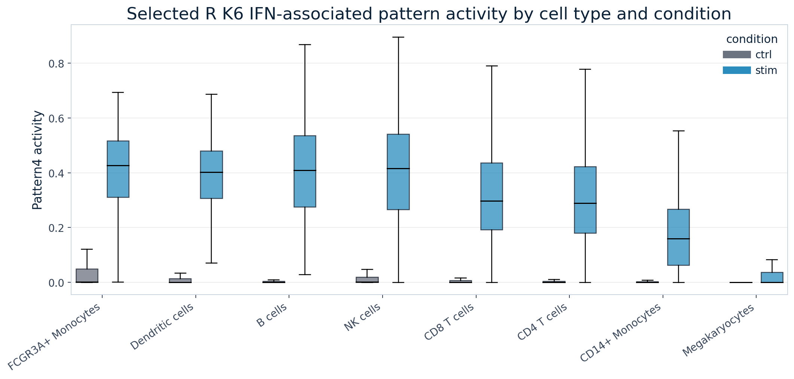

# **Summary**
***

## **Synopsis**
***

In this case study, we used a processed PBMC single-cell RNA-seq dataset with control and IFN-beta stimulated cells to learn how a latent-variable method can reveal transcriptional programs that cut across cell-type labels.

We inspected the processed single-cell object, summarized condition and cell-type metadata, prepared a genes x cells CoGAPS input, and loaded selected R-primary CoGAPS artifacts. The rank `K = 6` was selected before the main learner workflow using a limited model-selection sweep and follow-up pattern-structure comparison. Learners do not need to run that sweep to complete the case study.

The strongest stimulation-associated program in the selected R K6 model is the IFN-associated pattern, labeled `Pattern4` in that run. It is anchored by canonical interferon-stimulated genes, including `ISG15`, `ISG20`, `IFI6`, `IFIT3`, `IFIT1`, `MX1`, `IFIT2`, `IRF7`, `OAS1`, `PLSCR1`, and `BST2`.

We also examined expression direction because CoGAPS weights do not identify increases or decreases after stimulation. With all PBMC types combined, 14 of the top 15 IFN-associated genes had higher relative expression after stimulation in all eight donors; `FTH1` had lower expression in all eight. These directions agreed across the three normalization methods. They describe relative expression, not absolute changes in RNA molecules.

The cell-type comparison asked a separate question. `CD74` and the displayed HLA genes had higher relative expression in dendritic cells than in the remaining cell types combined in all six eligible donors. Several stimulation comparisons were less clear, with small means or directions that changed across normalization methods. The number of donors also matters: only one donor met the requirements for the megakaryocyte comparisons, so those results cannot show agreement across donors.

The IFN-associated pattern activity appears broad across PBMC cell types, supporting an activity-like IFN-response interpretation. Other patterns have interpretable gene anchors, such as myeloid and antigen-presentation genes, but those secondary interpretations should remain more cautious.

## **Summary Plot**
***

{fig-alt="Boxplots of selected R K6 IFN-associated CoGAPS pattern activity across PBMC cell types, split by control and IFN-beta stimulated conditions." width=800 .lightbox}

## **Main Questions Revisited**
***

Question | Current answer | Caveat
-------- | -------------- | ------
What latent transcriptional programs are present? | The selected `K = 6` model contains six patterns, including a strong IFN-associated pattern and several compartment-linked candidates. | Not every pattern has a settled biological label.
Can CoGAPS distinguish stimulation activity from cell-type-linked structure? | The IFN-associated pattern is consistent with a broad activity-like IFN program, while other patterns are more compartment-linked. | This is descriptive interpretation, not formal validation of all patterns.
Which genes define the strongest IFN-associated pattern? | The IFN-associated pattern is anchored by canonical interferon-stimulated genes. | Enrichment analysis would strengthen the final biological claim.
Are those genes up or down in stimulation? | Across all PBMCs, 14 top IFN-associated genes have higher relative expression after stimulation in all eight donors; `FTH1` has lower expression in all eight. | Directions agree across the tested methods; this is not a genome-wide differential-expression test.
How does the IFN-associated pattern vary across cell types? | Activity is broad, but the number of eligible donors and their agreement in expression direction vary by cell type. | Counts of genes with positive or negative means do not measure response strength; only one donor contributes to the megakaryocyte comparisons.

***
